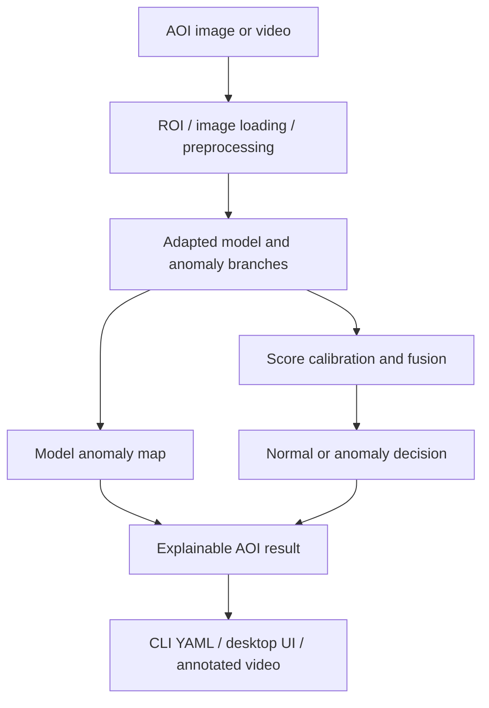

# Few-Shot AOI Inspection

A configuration-driven automated optical inspection (AOI) project for adapting
binary surface-anomaly detectors from small support sets, running image/video
inspection, reviewing anomaly heatmaps, and collecting operator feedback.

> **Public-release boundary:** this repository contains source code, tests, and
> configuration templates only. It does not contain customer or production images,
> datasets, trained task bundles, private weights, run outputs, or credentials. No
> project-wide software license has been granted yet; see [License](#license).

## Overview

The project supports an end-to-end AOI workflow: validate a product dataset, adapt a
multi-branch anomaly model, freeze a hashed model bundle, inspect images or videos,
and optionally create reviewed feedback revisions. The default demonstration
configuration targets the public DAGM2007 synthetic inspection benchmark; private
product data must be supplied through explicit custom configurations.

This is a research and engineering prototype. Its development metrics are not an
official competition score, a production acceptance result, or evidence of accuracy
on an unseen customer line.

## Features

- Single-image inference with YAML output.
- Video-file or camera inspection with annotated MP4 and timing summary.
- Native Tkinter desktop workflow for dataset import, adaptation, inspection,
  feedback review, activation, and rollback.
- Explicit `image_label` and `pixel_mask` adaptation modes.
- Configurable CPU/CUDA execution through PyTorch.
- Binary normal/anomaly decisions, branch scores, score fusion, and optional anomaly
  heatmaps.
- SHA-256 checks for model-bundle metadata and artifacts.
- DAGM2007 and legacy MVTec AD loaders plus a manifest-driven custom product path.
- Pytest coverage for data boundaries, runtime, feedback, UI smoke paths, benchmarks,
  and submission packaging.

## Architecture



In the current implementation, the model layer combines ResNet-based patch memories,
a frozen DINOv2 spatial representation, and a small known-defect head. The public API
exposes only the decision, fusion/branch scores, thresholds, and (when requested) an
anomaly map.

## Project Structure

```text
.
├── aoi/                         # Core training, runtime, feedback, UI, and CLI modules
├── assets/
│   ├── dinov2/                 # Pinned third-party DINOv2 code and Apache-2.0 license
│   └── demo/README.md          # Safe demo-input policy; no image is committed
├── configs/                    # DAGM demo, custom product, feedback, and benchmark YAML
├── data/README.md              # Expected dataset layout; datasets are ignored
├── docs/
│   ├── PROVENANCE.md           # Public asset/data provenance and release boundaries
│   └── images/README.md        # Local demo outputs; generated pixels are ignored
├── outputs/README.md           # Generated model/run output policy
├── scripts/generate_demo.py    # Real model anomaly-map visualization utility
├── tests/                      # Pytest suite
├── feedback_ui.py              # Native AOI desktop entry point
├── test.py                     # Image inference/evaluation/benchmark entry point
├── test_video.py               # Video/camera inference entry point
├── train.py                    # Adaptation/training entry point
├── requirements.txt            # Runtime dependencies
└── requirements-dev.txt        # Test dependency
```

## Requirements

- Python 3.10 (the verified release environment used Python 3.10.0).
- PyTorch 2.5.x and TorchVision 0.20.x.
- OpenCV 4.9+, NumPy 1.26+, Pillow 10+, PyYAML 6+, and SciPy 1.11+.
- Tk support plus `tkinterdnd2` for the optional desktop drag-and-drop workflow.
- CPU is supported. CUDA is optional; the verified smoke run used an NVIDIA RTX 4070.

TensorFlow, ONNX Runtime, and TensorRT are not used by the current runtime.
`xFormers` is optional; DINOv2 prints a warning and uses its standard attention path
when it is unavailable.

## Installation

Windows PowerShell:

```powershell
git clone https://github.com/casdad/few-shot-aoi-inspection.git
cd few-shot-aoi-inspection
python -m venv .venv
.\.venv\Scripts\python.exe -m pip install --upgrade pip
.\.venv\Scripts\python.exe -m pip install -r requirements.txt
```

For development and tests:

```powershell
.\.venv\Scripts\python.exe -m pip install -r requirements-dev.txt
.\.venv\Scripts\python.exe -m pytest -q
```

CUDA wheels may require a PyTorch install command appropriate for the local driver;
follow the current PyTorch installation selector before installing the remaining
requirements.

## Required Models and Data

No weights or datasets are committed. Before inference, provide:

1. An authorized `active_models.yaml` plus every model/calibration artifact referenced
   by its bundle.
2. Any common assets referenced by the bundle, normally under `assets/`.
3. An input image whose use is authorized.

The training configs additionally expect these public pretrained files:

```text
assets/dinov2_vits14_pretrain.pth
assets/resnet18-f37072fd.pth
assets/source_model.pt
```

Official download locations for the first two files are documented in
[docs/PROVENANCE.md](docs/PROVENANCE.md). `source_model.pt` and adapted task bundles
must be created from data you are authorized to use; the local copies used during
release verification were intentionally excluded.

For DAGM2007, download the dataset from the publisher and arrange it as shown in
[data/README.md](data/README.md). The repository does not redistribute benchmark
pixels.

## Usage

### Desktop AOI workflow

```powershell
python feedback_ui.py
```

The desktop UI is the primary operator entry point. It supports product task setup,
image/video inspection, optional label-only or mask-based feedback, reviewed feedback
candidate generation, activation, and rollback.

### Single-image inference

After placing DAGM data and a compatible adapted model bundle at the paths referenced
by `configs/infer_dagm_demo.yaml`:

```powershell
python test.py infer --config configs/infer_dagm_demo.yaml
```

The command prints YAML containing the resolved image, binary `decision`,
`fusion_score`, `fusion_threshold`, branch scores, and feedback state. It does not
claim that `fusion_score` is a calibrated probability.

For a product model, copy the demo YAML, set `active_models_pointer`, `category`, and
`image`, then run the same command with the new config.

### Real anomaly-map demo

```powershell
python -m scripts.generate_demo `
  --input data/dagm2007/Class1/Test/0002.PNG `
  --models outputs/dagm2007/active_models.yaml `
  --category Class1 `
  --device auto `
  --output-dir docs/images
```

This uses `AdaptedRuntime.predict_explain` and writes a source copy, the real model
anomaly heatmap, an annotated overlay, a three-panel comparison, and a YAML receipt.
The heatmap is not a ground-truth segmentation mask or bounding box.

### Video or camera inference

```powershell
python test_video.py input.mp4 `
  --category Class1 `
  --models outputs/dagm2007/active_models.yaml `
  --output outputs/video_test.mp4 `
  --summary outputs/video_test.yaml `
  --no-feedback
```

Use camera index `0` instead of `input.mp4` for a live source and add `--display` for
an interactive preview. The YAML timing summary states its measurement scope.

### Adaptation/training

The following is the real DAGM demo entry point, but it is intentionally not part of
the quick-start smoke test because it trains all selected categories:

```powershell
python train.py dagm-demo --config configs/train_dagm_demo.yaml
```

For private/product data, start from `configs/custom_train.example.yaml` and use:

```powershell
python train.py custom --config path/to/product_train.yaml
```

Do not use an independent validation/test set as support data or as an active-learning
pool.

## Inputs and Outputs

| Workflow | Input | Output |
| --- | --- | --- |
| Image inference | Image path + model-pointer YAML | YAML decision and score details on stdout |
| Demo visualization | Image + `active_models.yaml` | PNG input/heatmap/result/panel + YAML receipt |
| Video inspection | Video path or camera index + model pointer | Annotated MP4 + YAML timing summary |
| Training/adaptation | 100 normal + 30 defect support images for the configured protocol; masks optional by mode | Hashed bundle under `outputs/` + active pointer |
| Evaluation | Explicit dataset and frozen model-pointer config | Predictions and metrics under `outputs/` |
| Operator feedback | Reviewed image/video-frame feedback | Versioned records/candidates/revisions under `outputs/feedback/` |

## Demo

Release preparation executed the real model on the local DAGM2007 Class1 test image
`0002.PNG`, which has a published weak label mask. The warmed RTX 4070 run returned:

| Field | Measured value |
| --- | ---: |
| Decision | `anomaly` |
| Fusion score | `6.0` |
| Fusion threshold | `0.0` |
| Warmed inference | `95.4236 ms` |
| Model load | `2.4800 s` |

Timing covers one warmed `AdaptedRuntime.predict_explain` call, including its internal
preprocessing and score fusion, but excludes disk decode, model loading, and PNG
rendering. This single sample is a smoke result, not accuracy, mAP, FPS, or production
latency evidence.

The generated files were saved locally under `docs/images/` and visually inspected.
They are not committed because the checked DAGM publication record did not expose an
explicit redistribution license. Run the command above with your own authorized image
to regenerate the same artifact types; [docs/images/README.md](docs/images/README.md)
lists them.

## Model

- **Input:** an RGB image. The current branches perform their own internal resizing;
  the PatchCore-style branch uses 128×128 inputs and the DINOv2 branch uses 252×252.
- **Output:** a binary normal/anomaly decision, fusion score and threshold, branch
  diagnostics, and an optional anomaly map.
- **Defect type:** the current public runtime reports a generic binary anomaly, not a
  calibrated multi-class defect taxonomy.
- **Localization:** `predict_explain` produces a model anomaly heatmap. The runtime does
  not claim this is a bounding box or ground-truth segmentation.
- **Weights:** place authorized model assets under `assets/` and task bundles under
  `outputs/<task>/`, preserving paths referenced by `active_models.yaml`.

Bundle loading verifies recorded SHA-256 hashes when the bundle contains the current
integrity metadata.

## Testing

The release was verified on Windows with Python 3.10.0, PyTorch 2.5.1+cu121,
TorchVision 0.20.1+cu121, OpenCV 4.9.0, NumPy 1.26.4, Pillow 10.4.0, PyYAML 6.0.1,
SciPy 1.13.0, CUDA available, and an NVIDIA GeForce RTX 4070.

Executed checks:

```powershell
python -m pip check
python -m compileall .
python -m pytest -q
python test.py infer --config configs/infer_dagm_demo.yaml
python -m scripts.generate_demo --input data/dagm2007/Class1/Test/0002.PNG --models outputs/dagm2007/active_models.yaml --category Class1 --device auto --output-dir docs/images
```

Observed results at release preparation:

- `pip check`: no broken requirements.
- `compileall`: passed.
- Pytest in the complete local workspace: `214 passed, 1 skipped`.
- Pytest from a staged public-only export: `210 passed, 5 skipped`; four additional
  config-integration checks correctly skipped because the unpublished training assets
  were absent.
- Single-image CLI: exited `0` and returned `decision: false` for DAGM Class1
  `0001.PNG`.
- Explainable demo: exited `0`, returned `decision: true` for Class1 `0002.PNG`, and
  generated all declared files.

Tests that construct temporary fixture bundles do not require the excluded production
weights or datasets. Four configuration-integration tests explicitly skip when the
three required local training assets are absent. Real image inference requires a
complete compatible bundle.

## Results

Only the smoke outcomes in [Demo](#demo) and [Testing](#testing) are claimed here. No
accuracy, recall, F1, loss, mAP, throughput, hidden-test, RTX 2060, or production-line
claim is made by this public release.

## Limitations

- No trained task model, source model, dataset, or customer sample is distributed.
- A fresh clone cannot perform real inference until compatible authorized assets are
  supplied.
- The checked DAGM record did not provide an explicit redistribution license, so demo
  pixels are deliberately absent.
- The available local source model lacked a complete independently verified provenance
  receipt and was not uploaded.
- The runtime is binary normal/anomaly inspection; the anomaly map is not a certified
  defect mask and the score is not a probability.
- CUDA execution was smoke-tested only on an RTX 4070. CPU, other GPUs, and end-to-end
  camera/PLC integration were not performance-qualified for this release.
- Full training and full-dataset evaluation were not rerun during release preparation.
- Operator feedback revisions require enough disjoint reviewed training and validation
  records before activation.

## Security and Privacy

The repository ignore rules exclude environment files, credentials, common key files,
datasets, model/checkpoint formats, outputs, feedback captures, videos, archives,
temporary files, IDE state, internal audits, and competition packages. Always review
`git status` and the staged file list before publishing a new revision.

If you discover a credential or sensitive image in Git history, rotate/revoke the
credential first and then remove the data from history; deleting only the working-tree
file is insufficient.

## License

No project-wide license was present, and none has been selected automatically. Until
the copyright holder adds an explicit license, the original project source is
published without a grant of reuse, modification, or redistribution rights.

Third-party components retain their own licenses. In particular,
`assets/dinov2/LICENSE` applies to the bundled DINOv2 code and does not license the
rest of this project.
