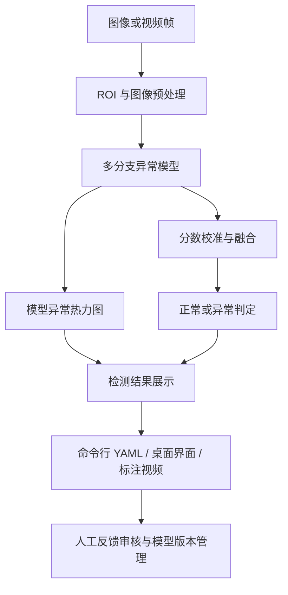

# Few-Shot AOI Inspection：小样本工业视觉异常检测

基于配置文件驱动的自动光学检测（AOI）项目，支持从少量正常 / 缺陷样本适配模型，完成图像与视频检测、异常热力图展示，以及人工反馈审核、模型版本激活和回滚。

> **公开版本说明**：仓库提供源码、测试与配置模板，**不包含数据集、训练权重、已适配任务模型包或客户图片**。刚克隆时不能直接运行真实图像推理，需要先准备兼容模型包。项目是研究与工程原型，不将开发记录作为正式比赛成绩或生产线验收结果。

[快速开始](#快速开始) · [模型与数据](#模型与数据) · [使用方法](#使用方法) · [目录说明](#目录说明) · [测试与历史记录](#测试与历史记录)

## 项目功能

| 功能 | 说明 |
| --- | --- |
| 小样本适配 | 根据协议使用正常 / 缺陷支持集，支持 `image_label` 与 `pixel_mask` 模式 |
| 图像检测 | 输出正常 / 异常判定、融合分数、阈值及分支诊断 |
| 视频与摄像头 | 输出标注 MP4 和 YAML 计时摘要，可选择实时预览 |
| 异常可视化 | 生成真实模型热力图、叠加结果和对比面板 |
| 桌面工作流 | Tkinter 界面，覆盖数据导入、适配、检测、反馈、激活与回滚 |
| 完整性检查 | 对带有当前完整性元数据的模型包校验 SHA-256 |
| 数据管理 | DAGM2007 演示、历史 MVTec AD 路径和自定义产品 manifest |
| 自动化测试 | 覆盖数据边界、运行时、反馈、UI、性能测试和打包 |

当前运行接口是 **正常 / 异常二分类**，不是多类别缺陷识别；融合分数不是校准后的概率，异常图也不等同于真实缺陷掩码或检测框。

## 系统流程



模型层结合 ResNet 特征的局部 patch 记忆、冻结的 DINOv2 空间表征和小型已知缺陷分类头。各分支内部自行调整图像尺寸：PatchCore 风格分支使用 128×128，DINOv2 分支使用 252×252。输出包括判定、融合 / 分支分数、阈值及按需生成的异常图。

## 目录说明

```text
few-shot-aoi-inspection/
├── aoi/                       训练、运行时、反馈、UI 与 CLI 核心代码
├── assets/
│   ├── dinov2/                固定版本的第三方 DINOv2 源码与许可
│   └── demo/                  演示输入放置说明，不含图片
├── configs/                   DAGM、自定义任务、反馈和性能测试配置
├── data/                      数据放置说明，不含数据集
├── docs/PROVENANCE.md          资源来源、权重 hash 和发布边界
├── docs/images/               本地可视化结果说明
├── outputs/                   生成的模型包、评估结果和反馈记录
├── scripts/generate_demo.py   真实模型热力图生成工具
├── tests/                     Pytest 测试
├── feedback_ui.py             桌面主入口
├── train.py                   模型适配 / 训练入口
├── test.py                    图像检测、评估和性能测试入口
├── test_video.py              视频 / 摄像头入口
├── requirements.txt           运行依赖
└── requirements-dev.txt       测试依赖
```

## 快速开始

### 安装环境

原发布验证环境为 Python 3.10。依赖约束包括 PyTorch `>=2.5,<2.6`、TorchVision `>=0.20,<0.21`，以及 OpenCV、NumPy、Pillow、PyYAML、SciPy。桌面界面需要 Tk 和 `tkinterdnd2`。

Windows PowerShell：

```powershell
git clone https://github.com/casdad/few-shot-aoi-inspection.git
cd few-shot-aoi-inspection
python -m venv .venv
.\.venv\Scripts\python.exe -m pip install --upgrade pip
.\.venv\Scripts\python.exe -m pip install -r requirements.txt
.\.venv\Scripts\Activate.ps1
```

后续命令均在**仓库根目录、已激活的虚拟环境**中执行。Linux / macOS 使用 `source .venv/bin/activate`。使用 GPU 时，应安装与本机驱动匹配且满足版本约束的 PyTorch / TorchVision 组合。

CPU 可作为执行设备，CUDA 可选；当前运行代码不依赖 TensorFlow、ONNX Runtime 或 TensorRT。`xFormers` 为可选项，未安装时 DINOv2 会警告并使用标准注意力路径。

### 查看入口

```bash
python train.py --help
python test.py --help
python test_video.py --help
```

`train.py` 和 `test.py` 不带模式参数时只显示帮助，不会自动启动训练或检测。

## 模型与数据

### 推理资源

准备兼容的 `active_models.yaml`、它引用的全部模型 / 校准文件、共享资源，以及获准使用的输入图像。保持指针与模型包内的路径一致，不要只复制一个权重而遗漏元数据。

默认 DAGM 演示模型指针为 `outputs/dagm2007/active_models.yaml`。模型包带有当前完整性元数据时，加载器会执行对应的 SHA-256 检查。

### 训练资源

配置引用以下文件，仓库均未附带：

```text
assets/dinov2_vits14_pretrain.pth
assets/resnet18-f37072fd.pth
assets/source_model.pt
```

前两项的来源名称和预期 hash 见 [资源来源说明](docs/PROVENANCE.md)。`source_model.pt` 与适配后的任务包需要通过获准使用的数据和相应流程准备，不能当作克隆后自动存在的文件。

DAGM2007 目录结构见 [数据说明](data/README.md)。自定义产品任务从 [训练配置模板](configs/custom_train.example.yaml) 和 [测试配置模板](configs/custom_test.example.yaml) 开始。

## 使用方法

### 桌面工作流

```bash
python feedback_ui.py
```

桌面界面是操作人员的主要入口，支持任务创建、图像 / 视频检测、标签或掩码反馈，以及经过审核的候选模型生成、激活与回滚。

### 单图检测

先准备演示数据和模型包，核对配置中的 `active_models_pointer`、`category` 和 `image`：

```bash
python test.py infer --config configs/infer_dagm_demo.yaml
```

默认图片为 `data/dagm2007/Class1/Test/0001.PNG`。结果以 YAML 输出到终端，包含 `decision`、`fusion_score`、`fusion_threshold`、分支分数和反馈状态。检测自己的产品时，复制 YAML 并修改上述字段，再用 `--config` 指定。

### 异常热力图

```bash
python -m scripts.generate_demo --input data/dagm2007/Class1/Test/0002.PNG --models outputs/dagm2007/active_models.yaml --category Class1 --device auto --output-dir docs/images
```

工具调用 `AdaptedRuntime.predict_explain`，生成原图副本、模型热力图、叠加图、三联对比图和 YAML 记录。文件清单见 [可视化输出说明](docs/images/README.md)。

### 视频与摄像头

```bash
python test_video.py input.mp4 --category Class1 --models outputs/dagm2007/active_models.yaml --output outputs/video_test.mp4 --summary outputs/video_test.yaml --no-feedback
```

将 `input.mp4` 换成 `0` 可选择摄像头，添加 `--display` 可预览。计时范围以输出的 YAML 摘要为准。

### 训练与适配

```bash
# 显式启动 DAGM 演示训练，会训练配置选定的类别
python train.py dagm-demo --config configs/train_dagm_demo.yaml

# 自定义任务：先复制并填写 custom_train.example.yaml
python train.py custom --config configs/product_train.yaml
```

当前演示协议使用 **100 张正常 + 30 张缺陷支持样本**；是否需要掩码取决于适配模式。自定义模板若提供独立测试集，还设置了至少 1,000 张测试图像及支持集 / 测试集 SHA-256 不重叠要求。

不要将独立验证 / 测试集放入支持集或主动学习池。DAGM 配置还有类别留出和汇总测试规模约束，少量随意放置的图像并不等同于满足完整协议。

### 评估与性能测试

```bash
python test.py evaluate --config configs/test_dagm_demo.yaml
python test.py benchmark --config configs/benchmark_dagm_demo.yaml

# 自定义任务：先填写独立测试配置
python test.py custom --config configs/product_test.yaml
```

具体数据、模型和设备取自 YAML。模板名称中出现 GPU 型号不代表已完成该硬件上的实测。

## 输入与输出

| 流程 | 输入 | 输出 |
| --- | --- | --- |
| 图像检测 | 图像 + 模型指针 YAML | 终端 YAML 判定和分数 |
| 可视化 | 图像 + 类别 + 模型包 | PNG 热力图 / 叠加图 / 面板与 YAML 记录 |
| 视频检测 | 视频或摄像头 + 模型包 | 标注 MP4 与计时摘要 |
| 训练 / 适配 | 符合协议的支持集和配置 | 带 hash 的模型包与活动模型指针 |
| 评估 | 显式数据配置 + 冻结模型 | `outputs/` 下的预测与指标 |
| 人工反馈 | 审核后的图像 / 帧反馈 | 版本化记录、候选模型和修订 |

## 测试与历史记录

### 自动化检查

```bash
python -m pip install -r requirements-dev.txt
python -m pip check
python -m pytest -q
```

使用临时夹具的测试不需要真实生产权重。四项配置集成检查在本地训练资源缺失时会跳过；真实推理仍要求完整模型包。

### 原发布记录

以下内容保留自原英文 README，**不是本次中文文档整理重新执行的结果**：

| 检查 | 原记录 |
| --- | --- |
| 完整本地工作区 Pytest | `214 passed, 1 skipped` |
| 仅公开文件导出副本 Pytest | `210 passed, 5 skipped` |
| 依赖 / 语法检查 | `pip check` 和 `compileall` 通过 |
| Class1 / `0001.PNG` 单图 CLI | 退出码 0，`decision: false` |
| Class1 / `0002.PNG` 可解释演示 | 退出码 0，`decision: true`，生成全部声明产物 |

原环境记录：Windows、Python 3.10.0、PyTorch 2.5.1+cu121、TorchVision 0.20.1+cu121、OpenCV 4.9.0、NumPy 1.26.4、Pillow 10.4.0、PyYAML 6.0.1、SciPy 1.13.0 与 RTX 4070。

原单样本演示还记录了融合分数 `6.0`、阈值 `0.0`、预热后推理 `95.4236 ms`、模型加载 `2.4800 s`。推理时间只覆盖一次 `predict_explain` 调用及内部预处理 / 融合，不包括磁盘解码、模型加载和 PNG 绘制。**这些不是准确率、mAP、稳定 FPS 或生产延迟结论。**

原演示像素未提交，原因是当时未确认数据再分发许可；可用自己的授权资源重新生成。本次只核对文档与源码入口，不新增完整训练、真实数据推理或硬件测速结论。

## 使用边界与发布说明

- 不分发训练权重、源模型、任务包、数据集或客户样本；新克隆需先准备资源。
- 异常热力图不是认证后的缺陷分割，分数不是概率。
- 原 CUDA 演示只记录了 RTX 4070，不据此宣称 CPU、RTX 2060 或其他设备性能。
- 全量训练、完整数据集评估、相机 / PLC 生产集成未在本次执行。
- 反馈模型激活前，需要数量足够且互不重叠的审核训练 / 验证记录。
- 保持 `.gitignore` 对数据、权重、反馈图片、视频、输出、凭据和本机配置的排除，发布前检查暂存文件。

## 许可与来源

项目尚未选择统一的软件许可证，本次仅整理文档，不新增授权条款。第三方组件继续使用各自许可证；[DINOv2 许可证](assets/dinov2/LICENSE) 仅适用于该第三方代码，不覆盖整个项目。

预训练资源、源模型边界与数据来源见 [PROVENANCE.md](docs/PROVENANCE.md)。
